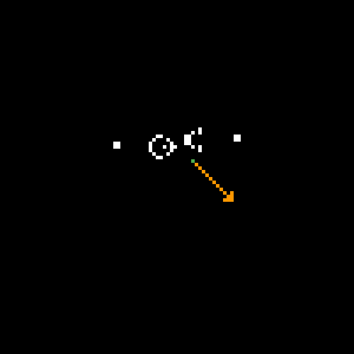

# Гра «Життя» Конвея — Розширені патерни

Браузерний симулятор **Гри «Життя» Конвея**, створений за допомогою HTML, ES-модулів JavaScript та HTML Canvas API. Симулятор використовує сітку розміром 100×100, дозволяє користувачеві малювати й розміщувати патерни, а також змінює стан сітки відповідно до чотирьох правил Конвея.



## Демоверсія

**Посилання на демо:** _Ще не розгорнуто — додайте сюди посилання на GitHub Pages або Vercel перед здачею проєкту._

## Рівень проєкту та реалізовані функції

**Виконаний рівень: Advanced — «It Surprises You».**

Проєкт містить функціонал рівнів Basic та Standard, а також додаткове завдання рівня Advanced — **Планерну гармату Госпера** (Gosper's Glider Gun).

- Клітинна сітка розміром 100×100.
- Правила Гри «Життя» Конвея з окремою сіткою для обчислення кожного наступного покоління.
- Безперервна симуляція з кнопками керування Play/Pause (Старт/Пауза), покрокового виконання (Step) та очищення (Clear).
- Налаштування затримки між поколіннями від 10 мс до 500 мс.
- Можливість натискати на клітинки, щоб зробити їх живими або мертвими.
- Чотири попередньо завантажені патерни: Планер (Glider), Мигалка (Blinker), Блок (Block) та Планерна гармата Госпера (Gosper's Glider Gun).
- Попередній перегляд патерну під курсором та його обертання на 90 градусів перед розміщенням.
- Опціональні лінії сітки та візуальні маркери для точки запуску гармати й напрямку руху планерів.
- Рендеринг на Canvas через буфер `ImageData` та метод `putImageData()`.

## Власне доповнення: візуальні підказки для патернів

Моїм власним доповненням є система візуальних підказок для зручного розміщення та розуміння патернів. Перед розміщенням обраний патерн відображається синім кольором під курсором для попереднього перегляду. Для планерної гармати Госпера також можна увімкнути зелений маркер точки запуску та помаранчеву стрілку, яка показує напрямок руху випущених планерів. Ці позначки можна вмикати або вимикати, а обраний патерн — обертати перед розміщенням на полі.

Я обрав це доповнення, оскільки досліджувати Гру «Життя» значно простіше, коли користувач бачить не лише окремі клітинки, а й орієнтацію великого патерну та напрямок, у якому рухатимуться створені ним фігури. Маркери є виключно візуальними підказками й не впливають на правила симуляції.

## Як запустити

### Вимоги

- Сучасний веббраузер із підтримкою модулів JavaScript.
- Локальний HTTP-сервер. Жодних зовнішніх JavaScript-бібліотек чи встановлення пакетів не потрібно.

### Локальний запуск

1. Помістіть файли `index.html`, `main.js`, `grid.js`, `logic.js` та `render.js` в одну папку проєкту.
2. Переконайтеся, що вхідний HTML-файл має назву **`index.html`**.
3. Відкрийте термінал у цій папці та запустіть локальний сервер:

   ```bash
   python -m http.server 8000
   ```

   У Windows можна використати команду `py -m http.server 8000`, якщо система не розпізнає `python`.
4. Відкрийте [http://localhost:8000](http://localhost:8000) у вашому браузері.

Проєкт використовує імпорт ES-модулів, тому пряме відкриття HTML-файлу за посиланням `file://` може бути заблоковане браузером. Натомість використовуйте локальний сервер.

## Керування

| Дія | Як використовувати |
|---|---|
| Старт / Пауза | Натисніть **Play** або клавішу `Space`, щоб запустити чи призупинити симуляцію. |
| Крок | Натисніть **Step**, щоб перейти рівно на одне покоління вперед. Якщо симуляція запущена, вона спочатку стане на паузу. |
| Очищення / Скидання | Натисніть **Clear**, щоб очистити сітку, скинути лічильник поколінь та видалити розміщені маркери гармати. |
| Редагування клітинки | Коли жоден патерн не обрано, натисніть на клітинку, щоб змінити її стан між живою та мертвою. |
| Розміщення патерну | Оберіть патерн у меню, наведіть курсор на полотно для попереднього перегляду, а потім натисніть, щоб розмістити його. |
| Обертання патерну | Натисніть **Rotate 90°** або клавішу `R`, коли обрано патерн. |
| Скасування розміщення патерну | Натисніть `Esc` або оберіть `-- Place Pattern --` у меню. |
| Показати / приховати лінії сітки | Натисніть **Grid: Off/On** або клавішу `G`. |
| Показати / приховати маркери | Натисніть **Marks: On/Off** або клавішу `M`. |
| Зміна швидкості симуляції | Використовуйте повзунок затримки або числове поле (10–500 мс). Натисніть `+`, щоб зменшити затримку та прискорити симуляцію; натисніть `-`, щоб збільшити затримку та сповільнити її. |

## Чотири правила Гри «Життя» Конвея

Сітка оновлюється по одному поколінню за раз. Кожна клітинка може бути або живою, або мертвою, а сусідами вважаються лише вісім навколишніх клітинок.

1. **Недостатня населеність (самотність):** Жива клітинка, яка має менше ніж двох живих сусідів, помирає.
2. **Виживання:** Жива клітинка з двома або трьома живими сусідами залишається живою.
3. **Перенаселення:** Жива клітинка, яка має більше ніж трьох живих сусідів, помирає.
4. **Розмноження:** Мертва клітинка, яка має рівно трьох живих сусідів, стає живою.

Усі інші мертві клітинки залишаються мертвими.

## Чому симулятор використовує окрему сітку для наступного покоління

Симулятор зчитує дані з поточної сітки та записує кожен результат у нову сітку. Лише після того, як обчислено стан кожної клітинки, поточна сітка замінюється новою.

Це важливо, оскільки всі клітинки мають змінюватися одночасно. Якби клітинка оновлювалася безпосередньо в тій самій сітці, з якої відбувається зчитування, наступні клітинки в межах того ж покоління бачили б уже оновлені значення. Тоді результат залежав би від порядку обробки клітинок і більше не відповідав би правилам Конвея.

У цьому проєкті функція `processNextGeneration()` створює та повертає новий екземпляр `Grid`, тому поточне покоління ніколи не змінюється під час його обчислення.

## Структура коду

```text
project-folder/
├── index.html                  # Розмітка сторінки, полотно (canvas), елементи керування та стилі
├── main.js                     # Стан симуляції, патерни, обробка введення та цикл анімації
├── grid.js                     # Зберігання сітки та безпечні методи отримання/встановлення/перемикання стану
├── logic.js                    # Підрахунок сусідів і правила переходу до наступного покоління
├── render.js                   # Рендеринг піксельного буфера на Canvas та візуальних маркерів
├── README.md                   # Опис проєкту та інструкції
└── assets/
    └── game-of-life-demo.gif   # 15-секундна демонстрація планерної гармати Госпера
```

### Основні модулі

- **`grid.js`** — визначає клас `Grid` та зберігає стани клітинок. Зчитування за межами сітки повертає `0` (мертва клітинка), а запис за межами сітки ігнорується.
- **`logic.js`** — підраховує вісім сусідів клітинки та обчислює наступне покоління за допомогою нового екземпляра `Grid`.
- **`main.js`** — керує сіткою 100×100, патернами, лічильником поколінь, циклом анімації, швидкістю, а також керуванням за допомогою миші та клавіатури.
- **`render.js`** — малює сітку та візуальні позначки в буфер `ImageData`, після чого відображає їх за допомогою `putImageData()`.

## Межі сітки та граничні випадки

Симулятор використовує скінченну сітку; вона **не** замикається по краях. Клітинка за межами сітки вважається мертвою. Клітинки патерну, які виходять за межі полотна під час розміщення, ігноруються.

Поточну реалізацію було перевірено на таких випадках:

- Порожня сітка 100×100 залишається порожньою після оновлення.
- Повністю заповнена живими клітинками сітка 100×100 коректно переходить до наступного покоління без виходу за межі масиву.
- Одинока жива клітинка на сітці 1×1 помирає, як і очікувалося.
- Блок 2×2, розміщений у верхньому лівому куті, залишається стабільним.
- Мигалка (Blinker) повертається до початкової орієнтації через два покоління.
- Планер (Glider) зміщується на одну клітинку по діагоналі вниз і вправо через чотири покоління.

## Продуктивність

- **Розмір сітки:** 100×100.
- **Метод рендерингу:** один буфер `ImageData` відмальовується за допомогою `putImageData()` замість малювання кожної клітинки як окремого прямокутника.
- **Затримка покоління за замовчуванням:** 50 мс.
- **Налаштовувана затримка покоління:** 10–500 мс.
- **Виміряний FPS у браузері:** 60 fps.

Затримка покоління визначає, як часто симуляція обчислює нове покоління. Вона працює окремо від циклу рендерингу кадрів анімації браузера, тому значення затримки не слід подавати як виміряний результат FPS.

## Команда

Індивідуальний проєкт

## Пункти, які потрібно завершити перед здачею

- [ ] Розгорнути браузерну версію та замінити заповнювач посилання вище на робочий URL.
- [x] Додати 15-секундну GIF-демонстрацію (`assets/game-of-life-demo.gif`).
- [ ] Виміряти та записати продуктивність у браузері на сітці 100×100.
- [ ] Перевірити, що проєкт запускається з репозиторію на чистому пристрої.
- [ ] Додати імена учасників та їхні обов'язки або вказати, що це індивідуальний проєкт.